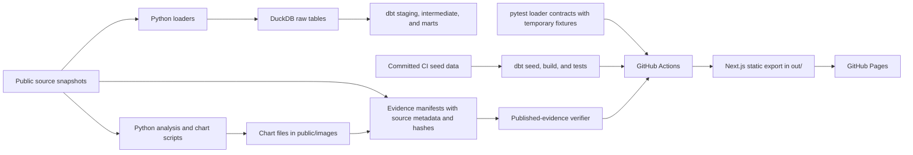

# Hadi Budhy Data Portfolio

[](https://github.com/hadibudhy/hadibudhy.github.io/actions/workflows/nextjs.yml)

A static portfolio of independent data projects using public data. The case studies show how I move from source data through models and tests to analysis that supports a decision. The site is built with Next.js App Router, TypeScript, Tailwind CSS, and Markdown case studies.

## Architecture



Local runs use downloaded public snapshots. Pytest creates temporary fixtures; dbt seed/build uses committed CI data. Python analysis scripts create chart assets separately from the dbt build. Checked-in evidence manifests record source metadata and hashes, and list chart artifacts and their hashes.

## Reproduce the Product Event model

This rebuilds the full-data DuckDB and dbt model outputs. The raw download stays outside Git.

```bash
python -m pip install -r analytics/requirements.txt
mkdir -p analysis_data/product-events
curl -L --fail \
  https://data.rees46.com/datasets/electronics-events/electronics-events.csv.gz \
  -o analysis_data/product-events/electronics-events.csv.gz

cd analytics
python load_rees46.py \
  --source ../analysis_data/product-events/electronics-events.csv.gz \
  --database target/ae_product.duckdb
dbt build --project-dir . --profiles-dir . \
  --select +fct_product_funnel +mart_event_quality --full-refresh
```

The [published evidence manifest](public/data/evidence/product-event-foundation.json) records the REES46 snapshot SHA-256 as `cbcbedc28c39a6b2add493bbbd9f71c061ad9d84087b85e64c442e4d47f418e7`. With that snapshot, the marts should report `source_rows = 885129`, `missing_session_rows = 165`, and `sum(purchase_sessions) = 20699`. You can inspect those outputs with:

```sql
select source_rows, missing_session_rows from mart_event_quality;
select sum(purchase_sessions) from fct_product_funnel;
```

The funnel uses the user ID and session ID pair as its session key. The CI seed is smaller and tests the model contract; it does not reproduce the full-data counts shown in the case study.

## What CI verifies

The workflow in `.github/workflows/nextjs.yml` installs the analytics dependencies, runs `analytics/tests/test_contracts.py` with temporary fixtures, builds dbt models and tests from committed CI seeds, verifies published evidence, lints the site, and builds the static export.

`scripts/verify_published_evidence.py` checks that published studies have valid manifests, required source/provenance fields, matching artifact lists, present chart files, and matching chart hashes. It also checks selected values for the Online Shoppers case. CI does not redownload every raw source or recalculate every published case-study result. The manifests retain source hashes and evidence boundaries so readers can see the source snapshot and limits behind each result.

## Develop locally

```bash
npm ci
npm run dev
```

Run the checks used by the workflow:

```bash
python -m pytest analytics/tests/test_contracts.py -q
python scripts/verify_published_evidence.py
npm run lint
npx tsc --noEmit --incremental false
npm run build
```

The production build writes the static site to `out/`. GitHub Actions uploads that directory to GitHub Pages after the checks pass.
